# Laporan Praktikum Jaringan Komputer – Modul 5 "Operation Geofront"

| Kelompok | Nama | NRP | Soal |
|---|---|---|---|
| K-17 | Dian Piramidiana Rachmatika | 5027251031 | 1–9 dan 11 |
| K-17 | Jude | - | 10 dan 12–20 |

Bagian laporan ini mencakup soal 1–9 dan 11. Soal 10 dan 12–20 dilaporkan oleh Jude.

Isi repositori: `artefak/` (tabel VLSM dan pohon IP), `skrip/` (konfigurasi dan skrip tiap router dan node), dan `dokumentasi/` (screenshot pengujian).

Seluruh topologi dikerjakan di GNS3 dengan blok alamat 10.72.0.0/16 untuk 17 LAN dan 16 link router ke router. Gendou menjadi akar pohon dan satu-satunya router yang tersambung ke NAT1.

## Daftar isi

1. [VLSM dan pohon IP](#soal-1--vlsm-dan-pohon-ip)
2. [IP interface router](#soal-2--ip-interface-router)
3. [Routing statis](#soal-3--routing-statis)
4. [NAT di Gendou](#soal-4--nat-di-gendou)
5. [Firewall di Gendou](#soal-5--firewall-di-gendou)
6. [IP node](#soal-6--ip-node)
7. [Pesan Lilith ke MAGI](#soal-7--pesan-lilith-ke-magi)
8. [Layanan TCP Pen-Pen dan Tokyo3-Core](#soal-8--layanan-tcp-pen-pen-dan-tokyo3-core)
9. [Perbaikan routing di Shigeru](#soal-9--perbaikan-routing-di-shigeru)
11. [Magi-Casper tidak bisa di-ping](#soal-11--magi-casper-tidak-bisa-di-ping)

---

## Soal 1 – VLSM dan pohon IP

### Perhitungan

Prefix induk 10.72.0.0/16.

1. Setiap LAN membutuhkan jumlah host ditambah satu alamat untuk gateway router. Ukuran blok adalah pangkat dua terkecil yang memuat kebutuhan itu beserta alamat network dan broadcast.
2. Setiap link antar-router membutuhkan dua alamat sehingga memakai blok /30.
3. Semua subnet diurutkan dari blok terbesar ke terkecil. Untuk ukuran yang sama, LAN didahulukan dari link, lalu mengikuti urutan pada tabel host. Alokasi berjalan dari 10.72.0.0 ke atas tanpa celah dan tanpa tumpang tindih.
4. Gateway adalah alamat usable pertama. Pada link, router yang lebih dekat ke Gendou memakai alamat pertama dan router di bawahnya memakai alamat kedua.
5. Terpakai = jumlah host + 1 gateway. Sisa = alamat usable − terpakai.

Alokasi berakhir di 10.72.4.171, sehingga seluruh 33 subnet muat dalam 10.72.0.0/16.

### Contoh perhitungan: Switch-Lab (Ritsuko)

Host yang tersambung: Entry-Plug = 3 dan Dummy-Plug = 2, total 5 host. Ditambah 1 alamat gateway menjadi 6 alamat terpakai. Dengan alamat network dan broadcast, dibutuhkan 8 alamat sehingga blok yang dipakai adalah /29 (2³ = 8, usable 6).

Dari urutan alokasi, subnet ini mendapat 10.72.4.48/29: network 10.72.4.48, gateway 10.72.4.49, host 10.72.4.50 sampai 10.72.4.54, broadcast 10.72.4.55. Terpakai 6 dan sisa 0.

### Tabel VLSM

| No | Subnet | Isi | Network/Prefix | Gateway | Broadcast | Terpakai | Sisa |
|---:|---|---|---|---|---|---:|---:|
| 1 | LAN Switch-Quarters (Rei) | Quarters=500 | 10.72.0.0/23 | 10.72.0.1 | 10.72.1.255 | 501 | 9 |
| 2 | LAN Switch-Comm (Hikari) | Comm-Net=200 | 10.72.2.0/24 | 10.72.2.1 | 10.72.2.255 | 201 | 53 |
| 3 | LAN Switch-Hangar (Yui) | Hangar-Crew=100 | 10.72.3.0/25 | 10.72.3.1 | 10.72.3.127 | 101 | 25 |
| 4 | LAN Switch-Bunker (Kensuke) | Sachiel=55 | 10.72.3.128/26 | 10.72.3.129 | 10.72.3.191 | 56 | 6 |
| 5 | LAN Switch-Medic (Maya) | Pen-Pen=1 + Medic-Bay=25 | 10.72.3.192/27 | 10.72.3.193 | 10.72.3.223 | 27 | 3 |
| 6 | LAN Switch-Relay (Kaworu) | Relay-Node=25 | 10.72.3.224/27 | 10.72.3.225 | 10.72.3.255 | 26 | 4 |
| 7 | LAN Switch-Garden (Shinji) | Garden-Staff=14 | 10.72.4.0/27 | 10.72.4.1 | 10.72.4.31 | 15 | 15 |
| 8 | LAN Switch-Dock (Mari) | Dock-Crew=12 | 10.72.4.32/28 | 10.72.4.33 | 10.72.4.47 | 13 | 1 |
| 9 | LAN Switch-Lab (Ritsuko) | Entry-Plug=3 + Dummy-Plug=2 | 10.72.4.48/29 | 10.72.4.49 | 10.72.4.55 | 6 | 0 |
| 10 | LAN Switch-Terminal (Fuyutsuki) | Magi-Casper=1 + Magi-Balthasar=1 + Magi-Melchior=1 | 10.72.4.56/29 | 10.72.4.57 | 10.72.4.63 | 4 | 2 |
| 11 | LAN Switch-Cage (Misato) | Unit-01=1 + Unit-02=1 + Unit-00=1 | 10.72.4.64/29 | 10.72.4.65 | 10.72.4.71 | 4 | 2 |
| 12 | LAN Switch-Dogma (Toji) | Lilith=1 + Adam=1 | 10.72.4.72/29 | 10.72.4.73 | 10.72.4.79 | 3 | 3 |
| 13 | LAN Switch-Monolith (Shigeru) | Zeruel=1 + Armisael=1 | 10.72.4.80/29 | 10.72.4.81 | 10.72.4.87 | 3 | 3 |
| 14 | LAN Switch-Radar (Makoto) | Radar-Array=4 | 10.72.4.88/29 | 10.72.4.89 | 10.72.4.95 | 5 | 1 |
| 15 | LAN Switch-Archive (Asuka) | Archive-Vault=1 | 10.72.4.96/30 | 10.72.4.97 | 10.72.4.99 | 2 | 0 |
| 16 | LAN Switch-Intel (Kaji) | Spy=1 | 10.72.4.100/30 | 10.72.4.101 | 10.72.4.103 | 2 | 0 |
| 17 | LAN Switch-Cmd (Gendou) | Tokyo3-Core=1 | 10.72.4.104/30 | 10.72.4.105 | 10.72.4.107 | 2 | 0 |
| 18 | Link Rei-Yui | 2 router | 10.72.4.108/30 | 10.72.4.109 | 10.72.4.111 | 2 | 0 |
| 19 | Link Hikari-Gendou | 2 router | 10.72.4.112/30 | 10.72.4.113 | 10.72.4.115 | 2 | 0 |
| 20 | Link Yui-Gendou | 2 router | 10.72.4.116/30 | 10.72.4.117 | 10.72.4.119 | 2 | 0 |
| 21 | Link Kensuke-Asuka | 2 router | 10.72.4.120/30 | 10.72.4.121 | 10.72.4.123 | 2 | 0 |
| 22 | Link Maya-Fuyutsuki | 2 router | 10.72.4.124/30 | 10.72.4.125 | 10.72.4.127 | 2 | 0 |
| 23 | Link Kaworu-Hikari | 2 router | 10.72.4.128/30 | 10.72.4.129 | 10.72.4.131 | 2 | 0 |
| 24 | Link Shinji-Yui | 2 router | 10.72.4.132/30 | 10.72.4.133 | 10.72.4.135 | 2 | 0 |
| 25 | Link Mari-Yui | 2 router | 10.72.4.136/30 | 10.72.4.137 | 10.72.4.139 | 2 | 0 |
| 26 | Link Ritsuko-Asuka | 2 router | 10.72.4.140/30 | 10.72.4.141 | 10.72.4.143 | 2 | 0 |
| 27 | Link Fuyutsuki-Gendou | 2 router | 10.72.4.144/30 | 10.72.4.145 | 10.72.4.147 | 2 | 0 |
| 28 | Link Misato-Gendou | 2 router | 10.72.4.148/30 | 10.72.4.149 | 10.72.4.151 | 2 | 0 |
| 29 | Link Toji-Fuyutsuki | 2 router | 10.72.4.152/30 | 10.72.4.153 | 10.72.4.155 | 2 | 0 |
| 30 | Link Shigeru-Gendou | 2 router | 10.72.4.156/30 | 10.72.4.157 | 10.72.4.159 | 2 | 0 |
| 31 | Link Makoto-Shigeru | 2 router | 10.72.4.160/30 | 10.72.4.161 | 10.72.4.163 | 2 | 0 |
| 32 | Link Asuka-Gendou | 2 router | 10.72.4.164/30 | 10.72.4.165 | 10.72.4.167 | 2 | 0 |
| 33 | Link Kaji-Gendou | 2 router | 10.72.4.168/30 | 10.72.4.169 | 10.72.4.171 | 2 | 0 |

Tabel yang sama tersedia di [artefak/tabel-vlsm.md](artefak/tabel-vlsm.md).

### Pohon IP

Jalur Dummy-Plug ke Armisael ditandai merah: Switch-Lab (10.72.4.48/29), link Ritsuko–Asuka (10.72.4.140/30), link Asuka–Gendou (10.72.4.164/30), link Gendou–Shigeru (10.72.4.156/30), lalu Switch-Monolith (10.72.4.80/29).

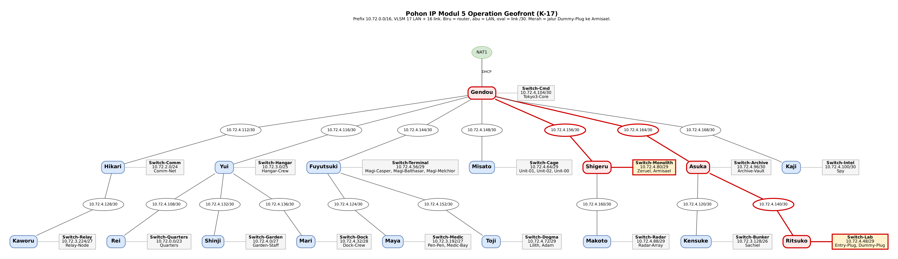

Berkas yang dapat disunting: [artefak/pohon-ip.drawio](artefak/pohon-ip.drawio).

---

## Soal 2 – IP interface router

### Aturan penomoran

- `eth0` terhubung ke router induk dan memakai alamat kedua pada link /30. Pada Gendou, `eth0` terhubung ke NAT1 dan mendapat alamat dari DHCP.
- `eth1` adalah gateway LAN dan memakai alamat usable pertama.
- `eth2` dan seterusnya terhubung ke router anak, diurutkan menurut jaringan link masing-masing, dan memakai alamat pertama pada link.

### Tabel IP router

| Router | Interface | IP/Prefix | Tersambung ke |
|---|---|---|---|
| Gendou | eth0 | DHCP (NAT1) | NAT1 |
| Gendou | eth1 | 10.72.4.105/30 | LAN Switch-Cmd |
| Gendou | eth2 | 10.72.4.113/30 | link ke Hikari |
| Gendou | eth3 | 10.72.4.117/30 | link ke Yui |
| Gendou | eth4 | 10.72.4.145/30 | link ke Fuyutsuki |
| Gendou | eth5 | 10.72.4.149/30 | link ke Misato |
| Gendou | eth6 | 10.72.4.157/30 | link ke Shigeru |
| Gendou | eth7 | 10.72.4.165/30 | link ke Asuka |
| Gendou | eth8 | 10.72.4.169/30 | link ke Kaji |
| Hikari | eth0 | 10.72.4.114/30 | link ke Gendou |
| Hikari | eth1 | 10.72.2.1/24 | LAN Switch-Comm |
| Hikari | eth2 | 10.72.4.129/30 | link ke Kaworu |
| Kaworu | eth0 | 10.72.4.130/30 | link ke Hikari |
| Kaworu | eth1 | 10.72.3.225/27 | LAN Switch-Relay |
| Yui | eth0 | 10.72.4.118/30 | link ke Gendou |
| Yui | eth1 | 10.72.3.1/25 | LAN Switch-Hangar |
| Yui | eth2 | 10.72.4.109/30 | link ke Rei |
| Yui | eth3 | 10.72.4.133/30 | link ke Shinji |
| Yui | eth4 | 10.72.4.137/30 | link ke Mari |
| Rei | eth0 | 10.72.4.110/30 | link ke Yui |
| Rei | eth1 | 10.72.0.1/23 | LAN Switch-Quarters |
| Shinji | eth0 | 10.72.4.134/30 | link ke Yui |
| Shinji | eth1 | 10.72.4.1/27 | LAN Switch-Garden |
| Mari | eth0 | 10.72.4.138/30 | link ke Yui |
| Mari | eth1 | 10.72.4.33/28 | LAN Switch-Dock |
| Asuka | eth0 | 10.72.4.166/30 | link ke Gendou |
| Asuka | eth1 | 10.72.4.97/30 | LAN Switch-Archive |
| Asuka | eth2 | 10.72.4.121/30 | link ke Kensuke |
| Asuka | eth3 | 10.72.4.141/30 | link ke Ritsuko |
| Kensuke | eth0 | 10.72.4.122/30 | link ke Asuka |
| Kensuke | eth1 | 10.72.3.129/26 | LAN Switch-Bunker |
| Ritsuko | eth0 | 10.72.4.142/30 | link ke Asuka |
| Ritsuko | eth1 | 10.72.4.49/29 | LAN Switch-Lab |
| Kaji | eth0 | 10.72.4.170/30 | link ke Gendou |
| Kaji | eth1 | 10.72.4.101/30 | LAN Switch-Intel |
| Misato | eth0 | 10.72.4.150/30 | link ke Gendou |
| Misato | eth1 | 10.72.4.65/29 | LAN Switch-Cage |
| Shigeru | eth0 | 10.72.4.158/30 | link ke Gendou |
| Shigeru | eth1 | 10.72.4.81/29 | LAN Switch-Monolith |
| Shigeru | eth2 | 10.72.4.161/30 | link ke Makoto |
| Makoto | eth0 | 10.72.4.162/30 | link ke Shigeru |
| Makoto | eth1 | 10.72.4.89/29 | LAN Switch-Radar |
| Fuyutsuki | eth0 | 10.72.4.146/30 | link ke Gendou |
| Fuyutsuki | eth1 | 10.72.4.57/29 | LAN Switch-Terminal |
| Fuyutsuki | eth2 | 10.72.4.125/30 | link ke Maya |
| Fuyutsuki | eth3 | 10.72.4.153/30 | link ke Toji |
| Maya | eth0 | 10.72.4.126/30 | link ke Fuyutsuki |
| Maya | eth1 | 10.72.3.193/27 | LAN Switch-Medic |
| Toji | eth0 | 10.72.4.154/30 | link ke Fuyutsuki |
| Toji | eth1 | 10.72.4.73/29 | LAN Switch-Dogma |

### Konfigurasi

Skrip tiap router ada di `skrip/router/<Router>/soal_2.sh` (untuk Gendou, bagian soal 2 pada `gendo.sh`). Isinya mengaktifkan IP forwarding dan memberi alamat pada tiap interface:

```sh
sysctl -w net.ipv4.ip_forward=1
ip addr flush dev ethX; ip addr add <ip>/<prefix> dev ethX; ip link set ethX up
```

Container GNS3 mempertahankan isi filesystem setelah Reload, tetapi proses dan aturan iptables hilang. Karena itu setiap konfigurasi dijalankan dari baris `up` di `/etc/network/interfaces`. Pada router, baris tersebut memanggil `/root/startup.sh`, yang menjalankan `soal_*.sh` secara berurutan (Gendou menjalankan `gendo.sh`). Berkas `interfaces`, `startup.sh`, dan skrip pendukung tiap router ada di folder `skrip/router/`.

### Pengujian

Perintah di setiap router: menampilkan hostname, alamat interface, lalu ping ke router tetangga.

```sh
bash /root/bukti_2.sh
```

Gendou:

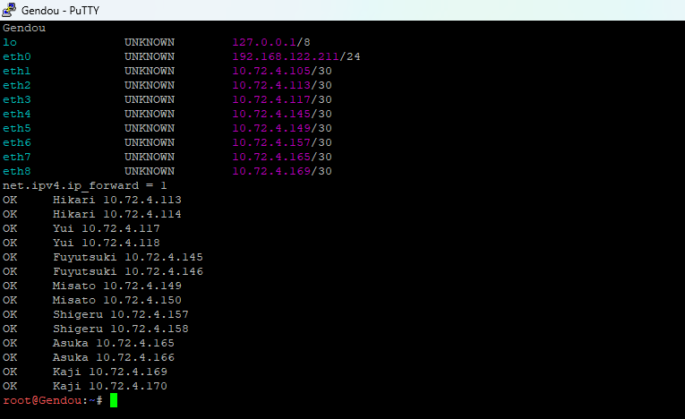

Hikari:

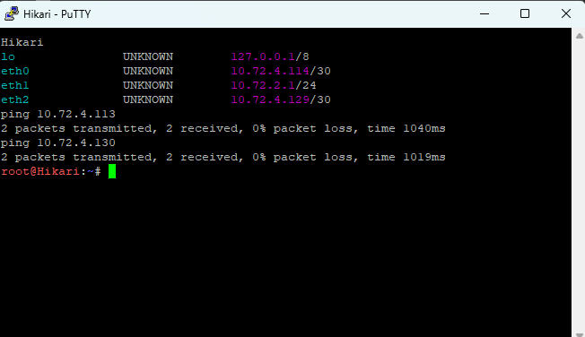

Kaworu:

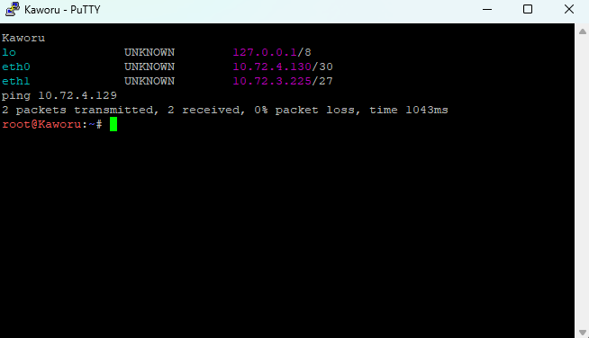

Yui:

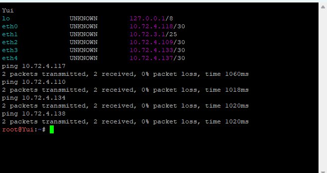

Rei:

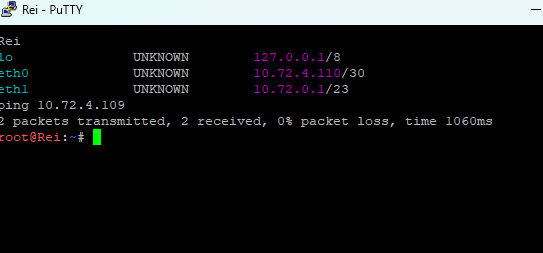

Shinji:

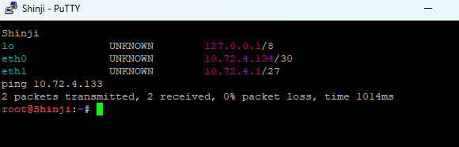

Mari:

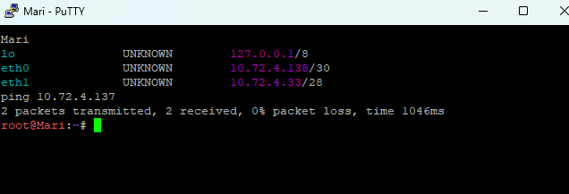

Asuka:

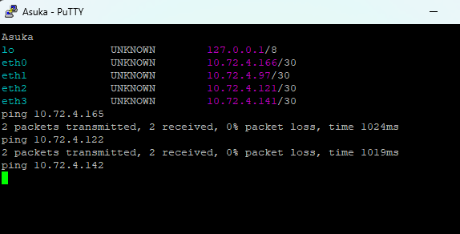

Kensuke:

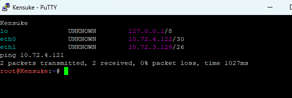

Ritsuko:

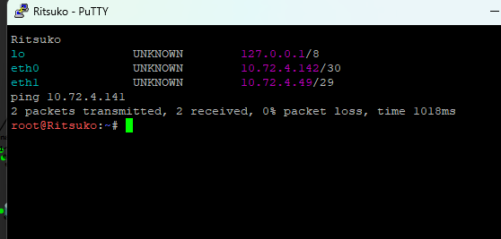

Kaji:

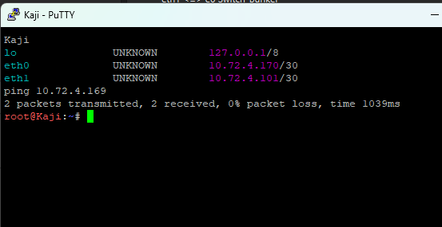

Misato:

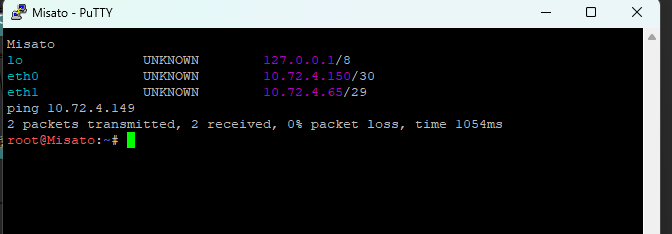

Shigeru:

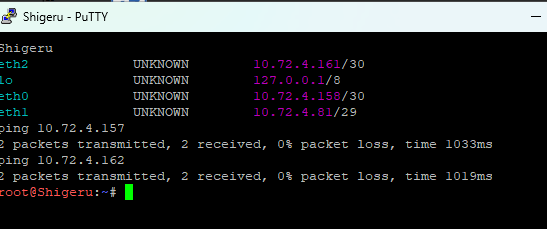

Makoto:

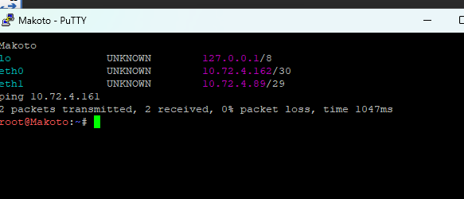

Fuyutsuki:

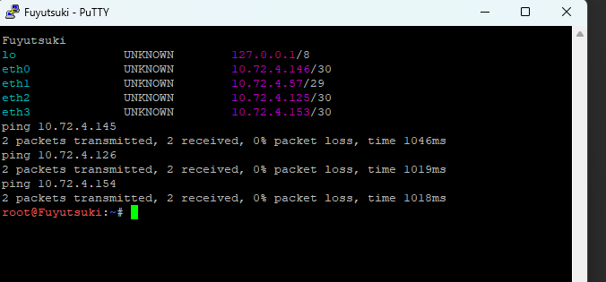

Maya:

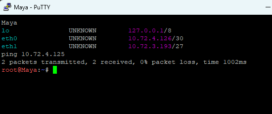

Toji:

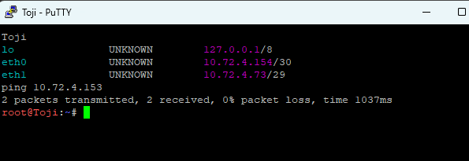

---

## Soal 3 – Routing statis

### Prinsip

- Router selain Gendou memakai default route ke router induknya, ditambah rute spesifik ke LAN dan link yang berada di bawah tiap anaknya.
- Gendou tidak punya induk. Default route-nya berasal dari DHCP pada `eth0` (NAT1), dan ia memiliki rute statis ke tiap subtree melalui anak-anaknya.
- Untuk tiap next hop, rute terdiri dari semua LAN di subtree anak tersebut ditambah link di bawah anak itu. Rute digabung hanya bila penggabungannya tepat tanpa meluaskan jangkauan. Satu-satunya penggabungan adalah 10.72.4.80/28 (Switch-Monolith 10.72.4.80/29 dan Switch-Radar 10.72.4.88/29 di bawah Shigeru).
- Default route selalu naik ke induk dan rute spesifik selalu turun ke anak, sehingga tidak terbentuk loop.

### Rute Gendou (24 rute statis dan default dari DHCP)

| Tujuan | Next hop | Lewat |
|---|---|---|
| 10.72.2.0/24 | 10.72.4.114 | Hikari |
| 10.72.3.224/27 | 10.72.4.114 | Hikari |
| 10.72.4.128/30 | 10.72.4.114 | Hikari |
| 10.72.0.0/23 | 10.72.4.118 | Yui |
| 10.72.3.0/25 | 10.72.4.118 | Yui |
| 10.72.4.0/27 | 10.72.4.118 | Yui |
| 10.72.4.32/28 | 10.72.4.118 | Yui |
| 10.72.4.108/30 | 10.72.4.118 | Yui |
| 10.72.4.132/30 | 10.72.4.118 | Yui |
| 10.72.4.136/30 | 10.72.4.118 | Yui |
| 10.72.3.192/27 | 10.72.4.146 | Fuyutsuki |
| 10.72.4.56/29 | 10.72.4.146 | Fuyutsuki |
| 10.72.4.72/29 | 10.72.4.146 | Fuyutsuki |
| 10.72.4.124/30 | 10.72.4.146 | Fuyutsuki |
| 10.72.4.152/30 | 10.72.4.146 | Fuyutsuki |
| 10.72.4.64/29 | 10.72.4.150 | Misato |
| 10.72.4.80/28 | 10.72.4.158 | Shigeru |
| 10.72.4.160/30 | 10.72.4.158 | Shigeru |
| 10.72.3.128/26 | 10.72.4.166 | Asuka |
| 10.72.4.48/29 | 10.72.4.166 | Asuka |
| 10.72.4.96/30 | 10.72.4.166 | Asuka |
| 10.72.4.120/30 | 10.72.4.166 | Asuka |
| 10.72.4.140/30 | 10.72.4.166 | Asuka |
| 10.72.4.100/30 | 10.72.4.170 | Kaji |
| default | dari DHCP di eth0 | NAT1 |

### Rute router lain

| Router | Default route | Rute tambahan |
|---|---|---|
| Hikari | via 10.72.4.113 | 10.72.3.224/27 via 10.72.4.130 |
| Kaworu | via 10.72.4.129 | - |
| Yui | via 10.72.4.117 | 10.72.0.0/23 via 10.72.4.110; 10.72.4.0/27 via 10.72.4.134; 10.72.4.32/28 via 10.72.4.138 |
| Rei | via 10.72.4.109 | - |
| Shinji | via 10.72.4.133 | - |
| Mari | via 10.72.4.137 | - |
| Asuka | via 10.72.4.165 | 10.72.3.128/26 via 10.72.4.122; 10.72.4.48/29 via 10.72.4.142 |
| Kensuke | via 10.72.4.121 | - |
| Ritsuko | via 10.72.4.141 | - |
| Kaji | via 10.72.4.169 | - |
| Misato | via 10.72.4.149 | - |
| Shigeru | via 10.72.4.157 | 10.72.4.88/29 via 10.72.4.162 |
| Makoto | via 10.72.4.161 | - |
| Fuyutsuki | via 10.72.4.145 | 10.72.3.192/27 via 10.72.4.126; 10.72.4.72/29 via 10.72.4.154 |
| Maya | via 10.72.4.125 | - |
| Toji | via 10.72.4.153 | - |

Skrip: `skrip/router/<Router>/soal_3.sh` (Gendou: bagian soal 3 pada `gendo.sh`). Perintah yang dipakai adalah `ip route replace`, sehingga skrip dapat dijalankan berulang.

### Pengujian

Dari Armisael ke node di tiga cabang lain: Lilith, Sachiel, dan Comm-Net (perintah terlihat pada gambar).

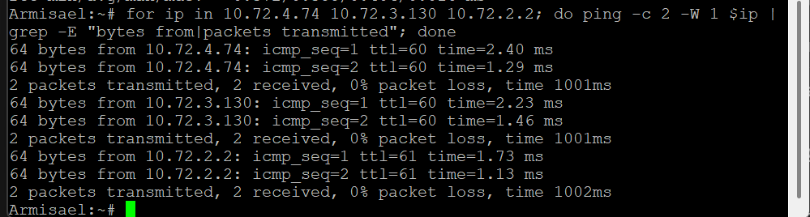

---

## Soal 4 – NAT di Gendou

Seluruh jaringan internal 10.72.0.0/16 keluar ke internet melalui NAT1 dengan aturan berikut di Gendou (bagian dari `gendo.sh`):

```sh
iptables -t nat -C POSTROUTING -s 10.72.0.0/16 -o eth0 -j MASQUERADE 2>/dev/null || \
iptables -t nat -A POSTROUTING -s 10.72.0.0/16 -o eth0 -j MASQUERADE
```

`MASQUERADE` dipilih karena alamat `eth0` Gendou diperoleh dari DHCP dan dapat berubah. Aturan ditulis berdasarkan interface keluar (`-o eth0`) sehingga tidak bergantung pada alamat NAT1. Pemeriksaan `-C` mencegah aturan ganda bila skrip dijalankan ulang.

Setiap node memakai DNS 8.8.8.8 melalui baris `up echo "nameserver 8.8.8.8" > /etc/resolv.conf` pada `/etc/network/interfaces`.

### Pengujian

Armisael:

```sh
cat /etc/resolv.conf
ping -c 2 8.8.8.8
ping -c 2 deb.debian.org
```

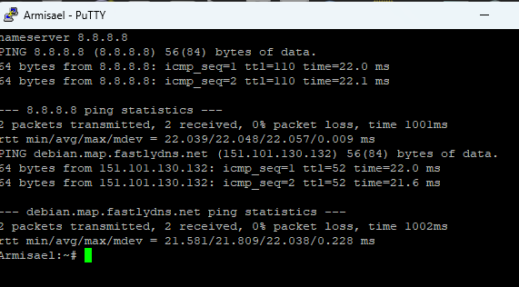

Lilith:

```sh
cat /etc/resolv.conf
ping -c 2 8.8.8.8
ping -c 2 deb.debian.org
```

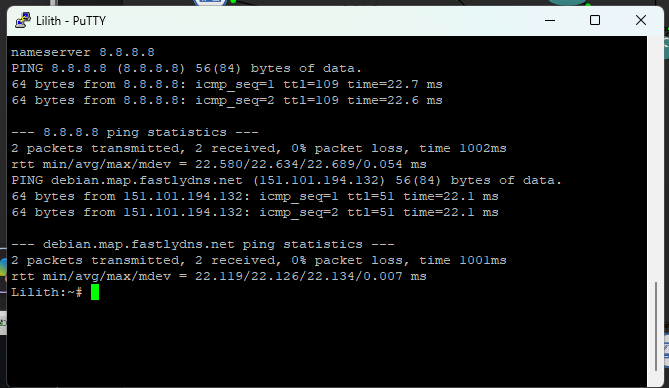

Gendou, aturan NAT beserta penghitung paketnya:

```sh
iptables -t nat -S POSTROUTING
iptables -t nat -L POSTROUTING -n -v
```

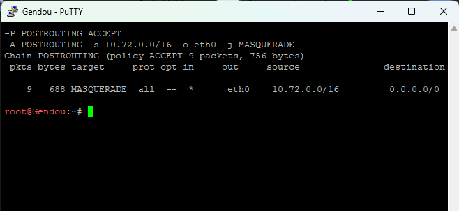

---

## Soal 5 – Firewall di Gendou

Gendou menerapkan kebijakan default-deny. Aturan berikut berada di `gendo.sh`:

| Chain | Aturan | Fungsi |
|---|---|---|
| INPUT | `-i lo` ACCEPT | proses lokal |
| INPUT | conntrack ESTABLISHED,RELATED ACCEPT | balasan koneksi yang dimulai Gendou |
| INPUT | `-i eth0 -p udp --sport 67 --dport 68` ACCEPT | balasan DHCP dari NAT1 |
| INPUT | `! -i eth0 -s 10.72.0.0/16` ACCEPT | jaringan internal menuju Gendou |
| FORWARD | conntrack ESTABLISHED,RELATED ACCEPT | balasan lalu lintas yang diteruskan |
| FORWARD | `! -i eth0 -s 10.72.0.0/16 -o eth0` ACCEPT | jaringan internal menuju internet |
| FORWARD | `! -i eth0 -s 10.72.0.0/16 -d 10.72.0.0/16` ACCEPT | antar-LAN |
| policy | INPUT DROP, FORWARD DROP | default deny |

Aturan lama dibersihkan lebih dulu dengan `iptables -F INPUT` dan `iptables -F FORWARD`. Kebijakan DROP dipasang paling akhir agar sesi yang sedang berjalan tidak terputus ketika skrip dieksekusi. Pengujian dilakukan dari sisi jaringan internal.

### Pengujian

Gendou, daftar aturan:

```sh
iptables -S
```

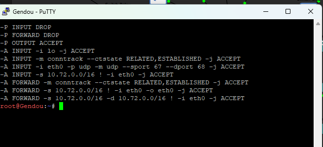

Armisael, akses internet tetap berjalan melalui Gendou:

```sh
date
ping -c 2 8.8.8.8
```

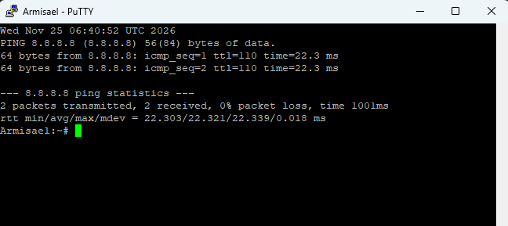

Gendou setelah Reload. Alamat, aturan NAT dan firewall, serta log `startup.sh` kembali terbentuk otomatis:

```sh
ip -br -4 a
iptables -S | head -3
iptables -t nat -S POSTROUTING
tail -4 /root/startup.log
```

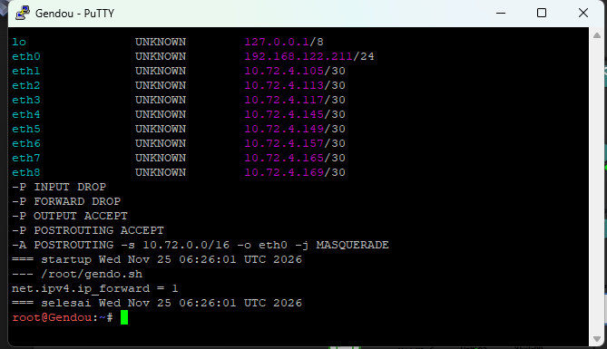

---

## Soal 6 – IP node

### Tabel IP node

| Node | IP | Netmask | Gateway | Switch |
|---|---|---|---|---|
| Quarters | 10.72.0.2/23 | 255.255.254.0 | 10.72.0.1 | Switch-Quarters |
| Comm-Net | 10.72.2.2/24 | 255.255.255.0 | 10.72.2.1 | Switch-Comm |
| Hangar-Crew | 10.72.3.2/25 | 255.255.255.128 | 10.72.3.1 | Switch-Hangar |
| Sachiel | 10.72.3.130/26 | 255.255.255.192 | 10.72.3.129 | Switch-Bunker |
| Medic-Bay | 10.72.3.194/27 | 255.255.255.224 | 10.72.3.193 | Switch-Medic |
| Pen-Pen | 10.72.3.195/27 | 255.255.255.224 | 10.72.3.193 | Switch-Medic |
| Relay-Node | 10.72.3.226/27 | 255.255.255.224 | 10.72.3.225 | Switch-Relay |
| Garden-Staff | 10.72.4.2/27 | 255.255.255.224 | 10.72.4.1 | Switch-Garden |
| Dock-Crew | 10.72.4.34/28 | 255.255.255.240 | 10.72.4.33 | Switch-Dock |
| Entry-Plug | 10.72.4.50/29 | 255.255.255.248 | 10.72.4.49 | Switch-Lab |
| Dummy-Plug | 10.72.4.51/29 | 255.255.255.248 | 10.72.4.49 | Switch-Lab |
| Magi-Casper | 10.72.4.58/29 | 255.255.255.248 | 10.72.4.57 | Switch-Terminal |
| Magi-Balthasar | 10.72.4.59/29 | 255.255.255.248 | 10.72.4.57 | Switch-Terminal |
| Magi-Melchior | 10.72.4.60/29 | 255.255.255.248 | 10.72.4.57 | Switch-Terminal |
| Unit-01 | 10.72.4.66/29 | 255.255.255.248 | 10.72.4.65 | Switch-Cage |
| Unit-02 | 10.72.4.67/29 | 255.255.255.248 | 10.72.4.65 | Switch-Cage |
| Unit-00 | 10.72.4.68/29 | 255.255.255.248 | 10.72.4.65 | Switch-Cage |
| Lilith | 10.72.4.74/29 | 255.255.255.248 | 10.72.4.73 | Switch-Dogma |
| Adam | 10.72.4.75/29 | 255.255.255.248 | 10.72.4.73 | Switch-Dogma |
| Zeruel | 10.72.4.82/29 | 255.255.255.248 | 10.72.4.81 | Switch-Monolith |
| Armisael | 10.72.4.83/29 | 255.255.255.248 | 10.72.4.81 | Switch-Monolith |
| Radar-Array | 10.72.4.90/29 | 255.255.255.248 | 10.72.4.89 | Switch-Radar |
| Archive-Vault | 10.72.4.98/30 | 255.255.255.252 | 10.72.4.97 | Switch-Archive |
| Spy | 10.72.4.102/30 | 255.255.255.252 | 10.72.4.101 | Switch-Intel |
| Tokyo3-Core | 10.72.4.106/30 | 255.255.255.252 | 10.72.4.105 | Switch-Cmd |

Gateway tiap node adalah alamat `eth1` router pada LAN-nya. Konfigurasi di `/etc/network/interfaces` mengikuti format berikut (berkas lengkap tiap node ada di `skrip/node/<Node>/interfaces`):

```
auto eth0
iface eth0 inet static
        address <ip>
        netmask <netmask>
        gateway <gateway>
        up echo "nameserver 8.8.8.8" > /etc/resolv.conf
```

### Pengujian

Unit-01, alamat, tabel routing, dan ping ke gateway:

```sh
ip -br a
ip route
ping -c 2 10.72.4.65
```

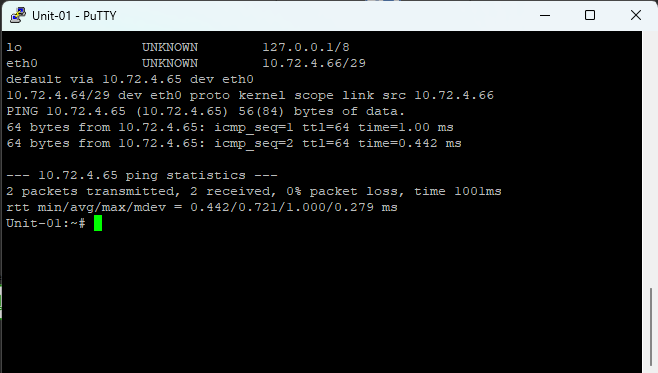

Gendou ke seluruh 25 node (perintah terlihat pada gambar, skrip setara: `skrip/uji_konektivitas.sh`):

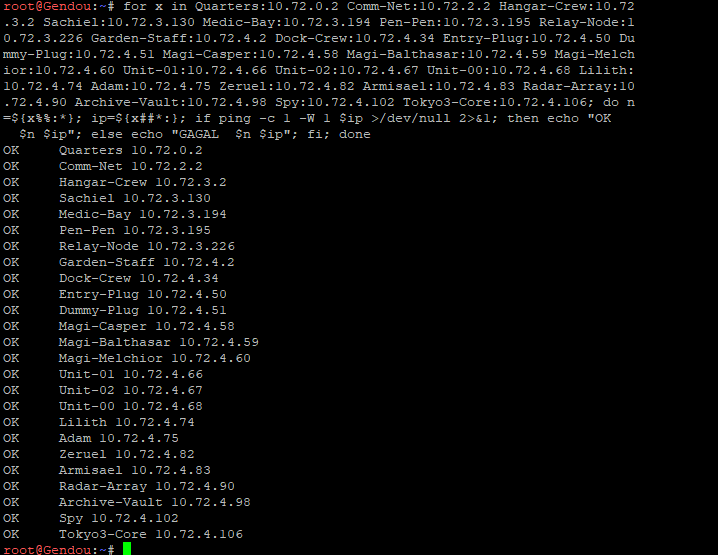

---

## Soal 7 – Pesan Lilith ke MAGI

Lilith mengirim pesan TCP ke Magi-Casper, Magi-Balthasar, dan Magi-Melchior. Tiap MAGI menjalankan listener `nc.traditional` dalam loop agar dapat menerima pesan berulang dan menyimpannya ke log:

```sh
while true; do nc.traditional -l -p 5000 >> /root/casper_5000.log; done
```

Magi-Balthasar mendengarkan di dua port (5000 dan 5001), sedangkan Casper dan Melchior di port 5000. Varian `netcat-traditional` dipakai karena mendukung opsi `-l -p` dan `-q`. Skrip: `skrip/node/Magi-*/Magi-*.sh`, dipanggil melalui baris `up` pada `interfaces`. Alamat: Casper 10.72.4.58, Balthasar 10.72.4.59, Melchior 10.72.4.60.

### Pengujian

Lilith, mengirim pesan ke setiap MAGI:

```sh
date
echo "Pesan dari Lilith untuk Casper" | nc.traditional -q 1 10.72.4.58 5000; echo "casper exit=$?"
echo "Pesan dari Lilith untuk Balthasar port 5000" | nc.traditional -q 1 10.72.4.59 5000; echo "balthasar-5000 exit=$?"
echo "Pesan dari Lilith untuk Balthasar port 5001" | nc.traditional -q 1 10.72.4.59 5001; echo "balthasar-5001 exit=$?"
echo "Pesan dari Lilith untuk Melchior" | nc.traditional -q 1 10.72.4.60 5000; echo "melchior exit=$?"
```

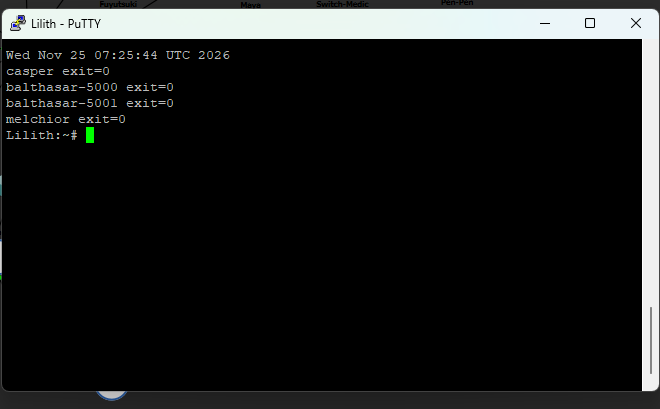

Magi-Casper:

```sh
hostname
cat /root/casper_5000.log
```

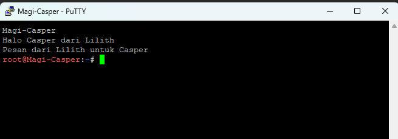

Magi-Balthasar:

```sh
hostname
echo "--- port 5000"; cat /root/balthasar_5000.log
echo "--- port 5001"; cat /root/balthasar_5001.log
```

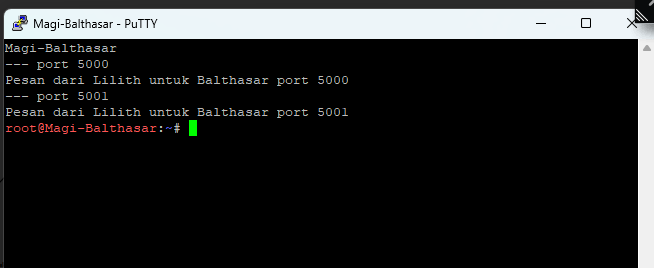

Magi-Melchior:

```sh
hostname
cat /root/melchior_5000.log
```

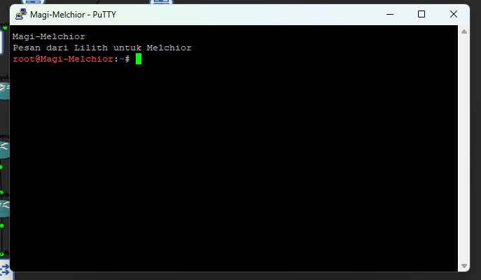

### Pengujian setelah Reload

Setelah node di-Reload, `ps -o pid,lstart,args -p 1` menunjukkan waktu mulai PID 1 yang baru, dan listener aktif kembali tanpa dijalankan manual.

Magi-Balthasar:

```sh
date
ps -o pid,lstart,args -p 1
ss -ltn | grep LISTEN
```

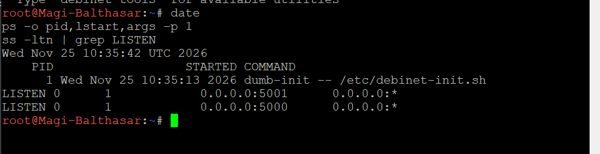

Magi-Melchior:

```sh
date
ps -o pid,lstart,args -p 1
ss -ltn | grep LISTEN
```

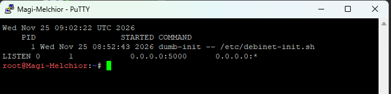

Magi-Casper (listener dan aturan soal 11):

```sh
date
ps -o pid,lstart,args -p 1
ss -ltn | grep LISTEN
iptables -S INPUT
```

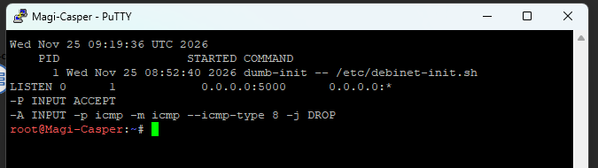

---

## Soal 8 – Layanan TCP Pen-Pen dan Tokyo3-Core

| Node | Alamat | Port | Jawaban |
|---|---|---|---|
| Pen-Pen | 10.72.3.195 | 80 | `Welcome to <hostname>` |
| Tokyo3-Core | 10.72.4.106 | 80 dan 8080 | `syifa imutz` |

Setiap koneksi dilayani oleh `nc.traditional -l -p <port> -q 1` dalam loop. Opsi `-q 1` menutup koneksi satu detik setelah input selesai agar klien tidak menggantung. Port tanpa listener, misalnya 22, langsung ditolak (RST) karena tidak ada aturan DROP pada kedua node. Skrip: `skrip/node/Pen-Pen/Pen-Pen.sh` dan `skrip/node/Tokyo3-Core/Tokyo3-Core.sh`.

### Pengujian

Lilith, mengakses layanan dan mencoba port 22 yang tidak dilayani:

```sh
date
echo "--- Pen-Pen:80";        nc.traditional -w 2 10.72.3.195 80 < /dev/null
echo "--- Tokyo3-Core:80";    nc.traditional -w 2 10.72.4.106 80 < /dev/null
echo "--- Tokyo3-Core:8080";  nc.traditional -w 2 10.72.4.106 8080 < /dev/null
echo "--- port 22 Pen-Pen (tidak dilayani)";     nc.traditional -w 2 10.72.3.195 22 < /dev/null; echo "exit=$?"
echo "--- port 22 Tokyo3-Core (tidak dilayani)"; nc.traditional -w 2 10.72.4.106 22 < /dev/null; echo "exit=$?"
date
```

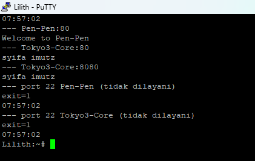

Pen-Pen setelah Reload:

```sh
date
ps -o pid,lstart,args -p 1
ss -ltn | grep LISTEN
```

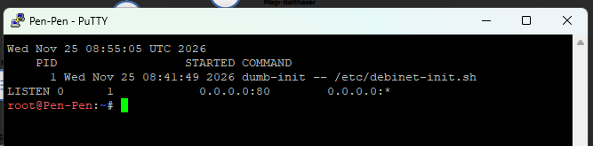

Tokyo3-Core setelah Reload:

```sh
date
ps -o pid,lstart,args -p 1
ss -ltn | grep LISTEN
```

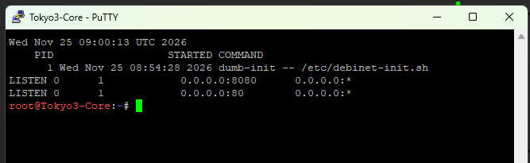

---

## Soal 9 – Perbaikan routing di Shigeru

### Kondisi

Setelah skrip gangguan dijalankan di Shigeru, Lilith dan Armisael tidak dapat saling terhubung, padahal Armisael masih dapat mem-ping gateway-nya sendiri (10.72.4.81).

### Metode

Sebelum gangguan, kondisi Shigeru disimpan ke `/root/kondisi_normal.txt` (isi `ip route`, `ip rule`, `ip -br a`, dan `sysctl net.ipv4.ip_forward`). Setelah gangguan, kondisi disimpan lagi ke `/root/kondisi_rusak.txt`, lalu keduanya dibandingkan dengan `diff`. Penyebab ditentukan dari selisih itu.

### Penyebab

1. `net.ipv4.ip_forward` bernilai 0, sehingga Shigeru tidak meneruskan paket antar-interface.
2. Default route berpindah ke Makoto (10.72.4.162 melalui `eth2`) padahal seharusnya ke Gendou (10.72.4.157 melalui `eth0`). Makoto sendiri memiliki default route kembali ke Shigeru sehingga paket berputar.
3. Terdapat `blackhole 10.72.4.72/29`, yaitu jaringan Lilith dan Adam. Prefix /29 lebih spesifik daripada default route sehingga rute blackhole yang dipakai (longest prefix match).
4. Terdapat aturan kebijakan `90: from all iif eth1 lookup 100`, dengan tabel 100 berisi `unreachable default`. Prioritasnya lebih tinggi daripada tabel main, sehingga semua paket yang masuk dari `eth1` (arah Zeruel dan Armisael) ditolak. Aturan ini tidak tampak pada `ip route` biasa, hanya pada `ip rule` dan `ip route show table 100`.

Ping ke gateway tetap berhasil karena 10.72.4.81 adalah alamat milik Shigeru sendiri (tabel `local`, prioritas 0), sehingga tidak melewati proses forwarding.

### Perbaikan

```sh
sysctl -w net.ipv4.ip_forward=1
ip route replace default via 10.72.4.157 dev eth0
ip route del blackhole 10.72.4.72/29
ip rule del iif eth1 lookup 100 priority 90
ip route flush table 100
```

### Pengujian

Lilith, sebelum gangguan:

```sh
ping -c 2 10.72.4.83
```

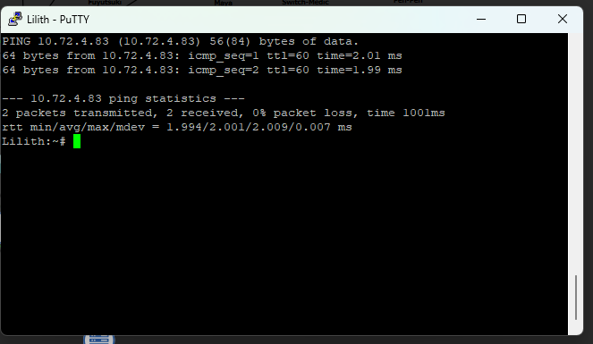

Shigeru, menjalankan skrip gangguan:

```sh
bash /root/break_routing.sh
```

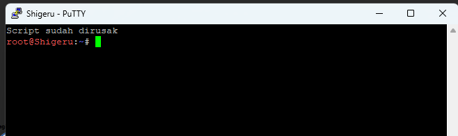

Lilith, setelah gangguan:

```sh
ping -c 2 -W 1 10.72.4.83
```

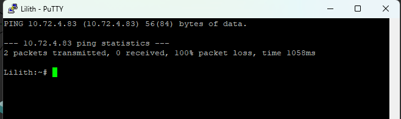

Armisael, setelah gangguan. Gateway terjangkau tetapi Lilith tidak:

```sh
ping -c 2 10.72.4.81
ping -c 2 -W 1 10.72.4.74
```

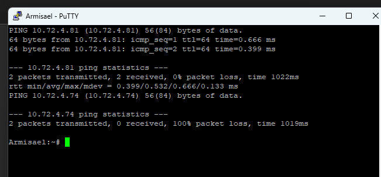

Shigeru, membandingkan kondisi normal dengan kondisi rusak:

```sh
diff /root/kondisi_normal.txt /root/kondisi_rusak.txt
```

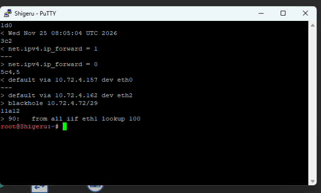

Shigeru, menjalankan perbaikan di atas lalu membandingkan kembali dengan kondisi normal. Selisih yang tersisa hanya baris tanggal:

```sh
sysctl -w net.ipv4.ip_forward=1
ip route replace default via 10.72.4.157 dev eth0
ip route del blackhole 10.72.4.72/29
ip rule del iif eth1 lookup 100 priority 90
ip route flush table 100
diff /root/kondisi_normal.txt /root/kondisi_pulih.txt
```

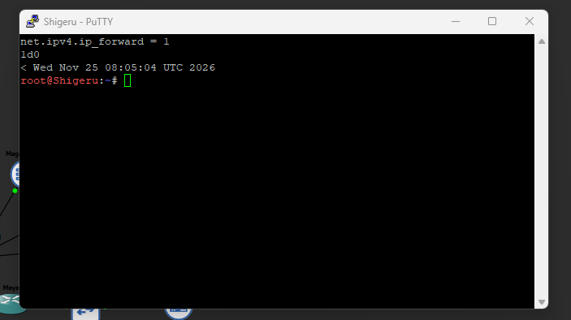

Lilith, setelah perbaikan:

```sh
ping -c 2 10.72.4.83
```

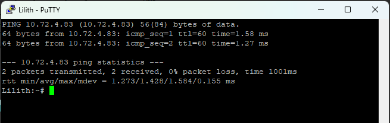

Armisael, setelah perbaikan:

```sh
ping -c 2 10.72.4.74
ping -c 2 8.8.8.8
```

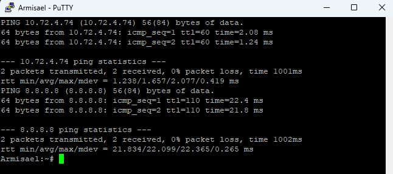

---

## Soal 11 – Magi-Casper tidak bisa di-ping

Magi-Casper dibuat tidak membalas ping, sementara layanan TCP port 5000 tetap dapat diakses. Aturan yang dipasang pada Casper:

```sh
iptables -A INPUT -p icmp --icmp-type echo-request -j DROP
```

Hanya `echo-request` yang masuk yang dibuang, sehingga:

- ping ke Casper tidak mendapat balasan (timeout),
- ping dari Casper ke node lain tetap berhasil karena balasan yang diterimanya adalah `echo-reply`,
- koneksi TCP port 5000 tidak terpengaruh karena bukan ICMP.

Skrip: `skrip/node/Magi-Casper/soal_11.sh`. Skrip memeriksa dengan `-C` terlebih dahulu agar aturan tidak ganda, dan dipanggil dari `interfaces` Casper bersama listener soal 7 sehingga aturan kembali setelah Reload.

### Pengujian

Magi-Casper, aturan dan listener:

```sh
iptables -S INPUT
ss -ltn | grep LISTEN
```

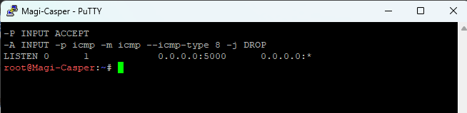

Magi-Balthasar, ping gagal tetapi koneksi TCP berhasil:

```sh
ping -c 2 -W 1 10.72.4.58
echo "tes dari Magi-Balthasar" | nc.traditional -q 1 10.72.4.58 5000; echo "nc exit=$?"
```

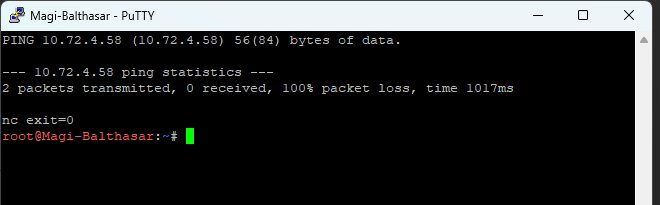

Lilith, ping gagal tetapi koneksi TCP berhasil:

```sh
ping -c 2 -W 1 10.72.4.58
echo "tes dari Lilith" | nc.traditional -q 1 10.72.4.58 5000; echo "nc exit=$?"
```

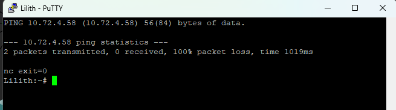

Magi-Casper, isi log yang diterima melalui TCP:

```sh
cat /root/casper_5000.log
```

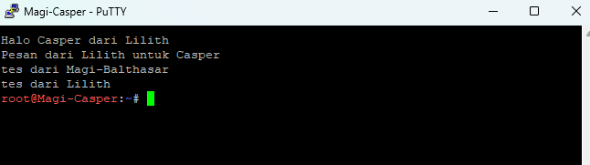

Magi-Casper, ping keluar tetap berhasil:

```sh
ping -c 2 10.72.4.59
ping -c 2 10.72.4.74
```

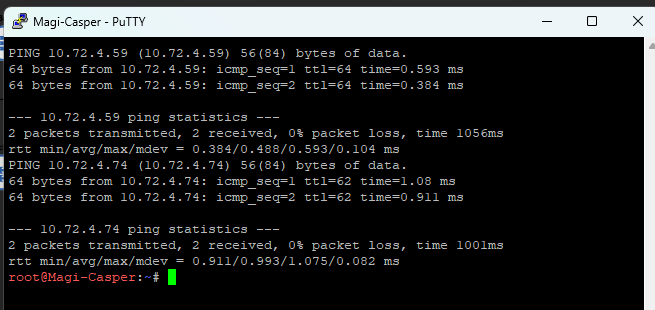

### Pengujian gabungan setelah Reload (soal 7, 8, dan 11)

Dari Lilith, setelah seluruh node layanan di-Reload: ping ke Casper tetap gagal, sedangkan semua koneksi TCP ke MAGI, Tokyo3-Core, dan Pen-Pen berhasil.

```sh
ping -c 2 -W 1 10.72.4.58
for t in 10.72.4.58:5000 10.72.4.59:5000 10.72.4.59:5001 10.72.4.60:5000 10.72.4.106:80 10.72.4.106:8080 10.72.3.195:80; do
  echo "--- $t"
  echo "uji" | nc.traditional -q 1 ${t%:*} ${t#*:}
  echo "exit=$?"
done
```


